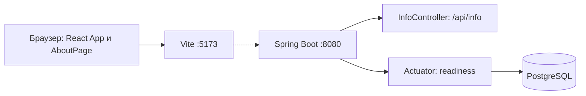

# Архитектура PolEvent

Документ описывает принятую основу проекта и предлагаемое устройство публичного каталога. Срез кода — `main` на коммите `2841077` от 24 ноября 2026 года. В этой версии объединены каркасы Spring Boot и React; локальное окружение, модель мероприятий и публичный API каталога ещё не перенесены.

Этап 06 подготовлен как проектная документация. Модель из этапа 05 должен подтвердить Дмитриев, а контракт запросов — владельцы backend и frontend перед реализацией этапов 07–08. Примеры будущих ответов приведены в [описании API](api.md); наличие примера не означает, что endpoint уже работает в GitHub.

## Границы текущей реализации

| Часть | Что есть в принятой основе | Что добавляется позднее |
| --- | --- | --- |
| Frontend | React, TypeScript, Vite, страницы `/` и `/about`, навигация и адаптивные стили | Афиша и карточка — 08; вход — 11; остальные формы — по плану |
| Backend | Spring Boot, точка запуска, `/api/info`, health/readiness, базовая конфигурация безопасности | Модель каталога — 05; его контроллеры и сервис — 07 |
| База | PostgreSQL-драйвер, JPA/Flyway и настройки подключения | Миграции и доменные сущности пока отсутствуют; V1 планируется в 05 |
| Запуск | Отдельные процессы Vite и Java JAR | Общая сборка с React внутри JAR и Docker Compose — 04 |
| Проверки | ESLint, TypeScript, Maven Checkstyle и команды сборки | Функциональные автотесты — начиная с 09; GitHub CI — 13 |

Исходный проект в GitLab содержит более полный продукт. Его функции и успешные старые прогоны не считаются автоматически перенесёнными или проверенными в GitHub.

## Как работают принятые каркасы

Пунктир обозначает уже настроенный прокси `/api` в Vite. Текущие страницы его ещё не вызывают. Браузер получает интерфейс от Vite, а Java-приложение запускается отдельно с доступной PostgreSQL. Readiness включает состояние подключения к БД.

- [main.tsx](../frontend/src/main.tsx) монтирует React и BrowserRouter; [App.tsx](../frontend/src/app/App.tsx) задаёт навигацию и маршруты. Неизвестная страница показывает экран «Страница не найдена».
- [vite.config.ts](../frontend/vite.config.ts) направляет будущие запросы `/api` на `http://127.0.0.1:8080`. Переходы и F5 на `/about` сейчас обслуживает Vite.
- [PolyventApplication](../backend/src/main/java/ru/ystu/polyvent/PolyventApplication.java) запускает Spring Boot. [ApplicationConfig](../backend/src/main/java/ru/ystu/polyvent/config/ApplicationConfig.java) предоставляет `Clock.systemUTC()` для серверного времени.
- [InfoController](../backend/src/main/java/ru/ystu/polyvent/common/InfoController.java) возвращает название и версию. Это единственный прикладной REST-контроллер принятого каркаса.
- [SpaController](../backend/src/main/java/ru/ystu/polyvent/config/SpaController.java) пока перенаправляет только `/` на `index.html`. Сборка React ещё не включена в JAR; это подготовка к этапу 04, а не работающий общий запуск.

## Предлагаемый путь запроса каталога

После этапов 05–08 запрос афиши проходит следующим образом:

1. React хранит выбранные категорию и дату в URL страницы и вызывает `GET /api/events` через клиентский модуль `frontend/src/api/events.ts`.
2. `EventController` принимает query-параметры и преобразует дату ISO в `LocalDate`.
3. `EventService` определяет временной интервал кампуса, задаёт публичный статус и вызывает репозиторий.
4. `EventRepository` выбирает опубликованные события из PostgreSQL с сортировкой по времени начала и ID.
5. Сервис преобразует сущности в `EventDto` внутри транзакции чтения. JPA-сущности напрямую в HTTP-ответ не передаются.
6. React показывает список, пустое состояние или ошибку с повторной загрузкой.

Для категорий исходный `EventController` обращается к `CategoryRepository` напрямую и строит `CategoryDto`: отдельной бизнес-логики у этого чтения нет. Карточка использует `EventService.findEvent` с проверкой статуса `PUBLISHED`.

Эти классы и страницы пока не присутствуют в принятой GitHub-основе. Имена и разделение взяты из ранней реализации исходника; подтверждение перенесённой версии относится к этапам 05 и 07.

## Модель каталога для этапа 05

Предлагаемая схема соответствует исходной миграции `V1__create_event_catalog.sql`.

| Таблица | Поля | Ограничения |
| --- | --- | --- |
| `categories` | `id`, `slug`, `name` | Первичный ключ `id`, уникальный обязательный `slug`, обязательное имя |
| `events` | `id`, `title`, `description`, `location`, `organizer_name`, `starts_at`, `category_id`, `status` | Обязательные поля, внешний ключ категории, допустимые статусы |

Одна категория содержит много мероприятий; каждое мероприятие относится к одной категории. `starts_at` имеет тип `TIMESTAMP WITH TIME ZONE`. Индексы V1 поддерживают выборку по статусу/времени и категории.

Начальные slugs: `culture`, `science`, `sport`, `community`, `career`, `volunteer`. Клиент получает ID из API и не привязывает код к конкретным числам категорий.

Схема допускает `DRAFT`, `PENDING`, `PUBLISHED`, `REJECTED` сразу, но переходы модерации появляются только на этапе 20. Публичный каталог читает исключительно `PUBLISHED`; внутренний статус не включается в первоначальный публичный DTO.

В V1 нет пользователей, владельца события, версии конкурентного изменения и фотографий. V2 добавляется при входе в 10, V3 — при ADMIN в 14, V4 — при управлении событиями в 17. Использование фото появляется в 23. Итоговый `CampusEvent` из GitLab нельзя копировать в ранний этап вместе с ещё отсутствующими зависимостями.

Flyway отвечает за изменение схемы по порядку миграций. `spring.jpa.hibernate.ddl-auto=validate` уже настроен: Hibernate не должен самостоятельно создавать или изменять таблицы. Применённые миграции не переписываются; новые изменения оформляются следующими миграциями. Демо-наполнение планируется управляемым и не должно сбрасывать существующие записи при перезапуске.

## Даты и время

API передаёт время события как ISO-строку с однозначной временной привязкой; серверная сущность использует `Instant`. В примерах ответы приведены в UTC с `Z`. Интерфейс кампуса отображает время в `Europe/Moscow`, независимо от часового пояса браузера.

Фильтр `date` — календарная дата кампуса, а не дата UTC. Для `date=2026-12-05` интервал равен `[2026-12-04T21:00:00Z, 2026-12-05T21:00:00Z)`. Начало включительно, конец исключительно.

В исходном алгоритме без `date` афиша начинается от текущего `Clock.instant()`. При указанной дате выбираются все события выбранных московских суток, включая уже начавшиеся в этот день. Публичная карточка проверяет статус, но не скрывает опубликованное событие только из-за прошедшего времени. Это поведение нужно сохранить или явно пересогласовать при переносе, а не неявно менять в клиенте.

## Публичная видимость и безопасность

[SecurityConfig](../backend/src/main/java/ru/ystu/polyvent/config/SecurityConfig.java) текущего каркаса разрешает GET, открывает health и закрывает остальные actuator endpoints. Изменяющие операции не предоставлены; CSRF-защита сохранена. Пустой `UserDetailsService` предотвращает создание демонстрационного пользователя со случайным паролем по умолчанию. Прикладных аккаунтов, регистрации и ролевых кабинетов в принятом каркасе ещё нет.

После переноса каталога видимость определяется серверной выборкой: черновики не попадают в список и дают 404 при прямом публичном чтении. Скрытие карточки только в React не является проверкой доступа.

Сессии, BCrypt, роли и проверка владельца относятся к следующим этапам 10–23. Даже после их переноса регистрация аккаунта не означает запись студента на мероприятие: модуль участия отсутствует и в исходной версии.

## Упаковка и окружения

Сейчас frontend собирается в `frontend/dist`, backend — в `backend/target/polyvent.jar`; процессы запускаются отдельно. Инструкции находятся в [README](../README.md).

На этапе 04 Томилов добавляет включение `frontend/dist` в статические ресурсы JAR, маршруты SPA для уже существующих страниц и Docker Compose с PostgreSQL. После этого интерфейс и `/api` смогут обслуживаться одним приложением. Неизвестные API и файлы должны сохранять корректный 404, а не превращаться в `index.html` с HTTP 200.

Адрес БД и её учётные данные читаются из окружения. Переменные `APP_PORT` и `APP_VERSION` управляют портом и ответом `/api/info`. Локальные пароли, `.env`, токены и данные БД не входят в Git. Приложение и тесты должны использовать разные базы.

GitHub Actions планируется отдельно на этапе 13. Наличие `.gitlab-ci.yml` в исходнике не запускает CI на GitHub. Перенос серверной конфигурации относится к 29 и не означает разрешение на изменение действующего сервера.

## Что требуется для принятия этапа 06

| Проверка | Ответственный и этап |
| --- | --- |
| Схема V1 и классы соответствуют описанию; модель принята в `main` | Дмитриев, 05 |
| Поля DTO, фильтры, статусы и ошибки API подтверждены перед реализацией | Дмитриев и Белов, 06–08 |
| Афиша содержит только опубликованные события, карточка черновика недоступна — ФТ-03/05 | Смольянов, 09 после 07–08 |
| Категория и московская дата сочетаются, сброс возвращает исходную выборку — ФТ-04 | Смольянов, 09 |
| Время API и отображение кампуса согласованы | Дмитриев, Белов и Смольянов, 07–09 |
| Документация не выдаёт будущие функции за уже перенесённые | Кононов, при обновлении документов |

Сейчас выполнена сверка документации с принятой основой и исходным кодом. Согласование с перенесённой V1 и проверка будущих HTTP-сценариев ожидают соответствующих этапов; API каталога в GitHub не считается принятым.

## Источники

- Принятая [основа GitHub](https://github.com/MoggBug/Polyvent/tree/28410773f82996170b8e5be1a877fca10ff9f786) и локальные файлы, на которые даны ссылки выше.
- [Ранняя реализация каталога в GitLab](https://gitlab.com/aza954/polyvent/-/tree/68bda1c/backend/src/main): модель V1, DTO и алгоритм чтения без поздних пользователей и фото.
- [Итоговый исходник](https://gitlab.com/aza954/polyvent/-/tree/0e800308aa6c4d35bdd707d1ced1bf80d9b7841e), [требования](requirements.md) и [план переноса](GITHUB_COMMIT_PLAN.md).
